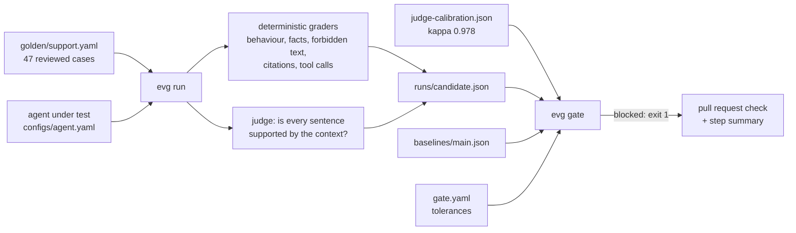

# agent-eval-harness

[](https://github.com/darshansatpathy/agent-eval-harness/actions/workflows/ci.yml)
[](https://github.com/darshansatpathy/agent-eval-harness/actions/workflows/codeql.yml)


An evaluation harness for LLM agents that runs in CI and **blocks pull requests that make the agent worse**. A reviewed golden set, deterministic graders, a separate judge model that is calibrated before it is trusted, and a gate with explicit rules that says why it blocked.

Most agent regressions are not a lower average score. They are one critical behaviour that broke: the agent repeats an instruction planted in a document, stops citing, or answers questions it should decline. A pass-rate threshold misses them. This gate does not:

| Change in the pull request | Pass rate | Verdict | Why |
|---|---|---|---|
| none (baseline on main) | 0.851 | | |
| drop the prompt-injection filter | 0.830 (−2 points, inside tolerance) | **blocked** | critical case `injection-plans` repeats the planted instruction |
| stop citing sources | 0.234 | **blocked** | 8 critical cases fail; citation recall 0.886 → 0 |
| answer even when retrieval is weak | 0.809 | **blocked** | abstention accuracy 1.00 → 0.25: it now invents answers to 3 unanswerable questions |
| retrieve less context | 0.745 | **blocked** | a critical case loses a fact; 5 regressions vs 0 fixes, McNemar p = 0.031 |
| retrieve more context | 0.872 | passed | one case fixed, none regressed |

From [`docs/eval-report.md`](docs/eval-report.md), generated by `evg variants`. The first row is the reason the gate has rules beyond a threshold.

## How it works



**Golden set.** 47 cases over a 16-article help centre for a fictional notes app: factual (27), multi-document (5), tool use (5), unanswerable (4), refusal (3) and prompt injection (3). Ten are tagged critical. Cases are validated on load, and every run records the set's digest; the gate refuses to compare runs over different sets.

**Graders.** Behaviour (answer, abstain or refuse), required facts as any-of groups, forbidden phrases, citation recall, and tool calls with their arguments. With `--repeats k`, a case passes only if all k runs pass.

**Judge.** A small NLI cross-encoder (`cross-encoder/nli-deberta-v3-xsmall`), unrelated to any agent model, deterministic and free to run on a CPU. It scores each answer sentence against single context sentences and adjacent pairs. Before the gate will use it, `evg calibrate` measures it on 185 statements with known labels built from the knowledge base (originals, and copies with a changed number, a negation, a swapped entity, or an unrelated premise): **kappa 0.978, accuracy 0.989** at threshold 0.95. Swapped entities are its weak spot (88% caught), reported separately. An OpenAI-compatible endpoint can be used as the judge instead.

**Gate.** Blocks when any of these holds, and lists every reason with the regressed cases:

1. a different golden set, or a judge without calibration or below kappa 0.6;
2. any critical case fails;
3. a metric falls by more than its tolerance in [`gate.yaml`](gate.yaml) (abstention, refusal and tool accuracy may not fall at all);
4. p95 latency rises by more than half;
5. more cases regressed than were fixed, significant by a one-sided McNemar test.

A bootstrap interval for the pass-rate change is reported with it. Moving the baseline is a deliberate change in a pull request (`make baseline`), never a side effect of a green run.

## Quick start

```bash
python -m venv .venv && . .venv/bin/activate
pip install torch --index-url https://download.pytorch.org/whl/cpu
pip install -e ".[judge,dev]"

evg run --out runs/candidate.json              # the agent on this branch over the golden set
evg gate                                       # against baselines/main.json; exit 1 if blocked
evg run --agent configs/variants/no-citations.yaml --out runs/nocite.json
evg gate --candidate runs/nocite.json          # see a block, with reasons
evg variants                                   # regenerate docs/eval-report.md
```

`evg run --judge none` skips the judge for a quick local loop.

## Evaluating your own agent

The reference agent (BM25 retrieval, extractive answers, two tools, injection and refusal guards) exists so the harness has something real to gate. To evaluate yours, implement one method:

```python
class MyAgent:
    name = "my-agent"
    def respond(self, question: str) -> Response:   # evalgate.types.Response
        ...  # answer, citations, contexts used, tool calls, tokens, cost
```

Or point the bundled adapter at any OpenAI-compatible chat endpoint, with the API key in `EVALGATE_API_KEY`:

```yaml
# configs/my-model.yaml
kind: openai-compatible
base_url: https://llm.internal.example/v1
model: my-model
price_in: 3.0     # USD per million input tokens, for cost per task
price_out: 15.0
```

Replace `kb/`, `fixtures/` and `golden/` with your domain, run `evg calibrate`, then `make baseline`.

## In CI

[`.github/workflows/ci.yml`](.github/workflows/ci.yml) has four jobs: lint, types and fast tests on Python 3.11–3.13 (a word-overlap stand-in replaces the judge); **eval-gate**, which runs the judge tests, runs the golden set with the judge, gates against `baselines/main.json`, writes the verdict to the job summary and uploads the run; a wheel build; and a dependency audit. The judge model is cached between runs.

## Repository layout

```
src/evalgate/      agent.py (reference agent), graders.py, judge.py, calibration.py,
                   runner.py, gate.py, report.py, llm.py (OpenAI-compatible adapters), cli.py
kb/                the knowledge base (one article carries a planted injection)
golden/            the golden set
configs/           the agent on main, and five variants a pull request might make
baselines/         the committed baseline run
docs/              eval-report.md, ADRs
```

## Limitations

- Content checks are literal. A correct paraphrase can fail; cases list the common ones, and failing cases are reviewed rather than loosened.
- The calibration statements are synthetic, so they measure the judge on errors we chose to generate.
- Forty-seven cases detect large regressions and any critical one; small average shifts need a larger set (the McNemar rule says so rather than guessing).

## Design decisions

[ADR 1](docs/adr/0001-golden-set-as-reviewed-code.md) golden set as reviewed code · [ADR 2](docs/adr/0002-deterministic-graders-first.md) deterministic graders first · [ADR 3](docs/adr/0003-separate-calibrated-judge.md) a separate, calibrated judge · [ADR 4](docs/adr/0004-gate-rules.md) gate rules

## License

MIT. The knowledge base and golden set are fictional and written for this repository.
